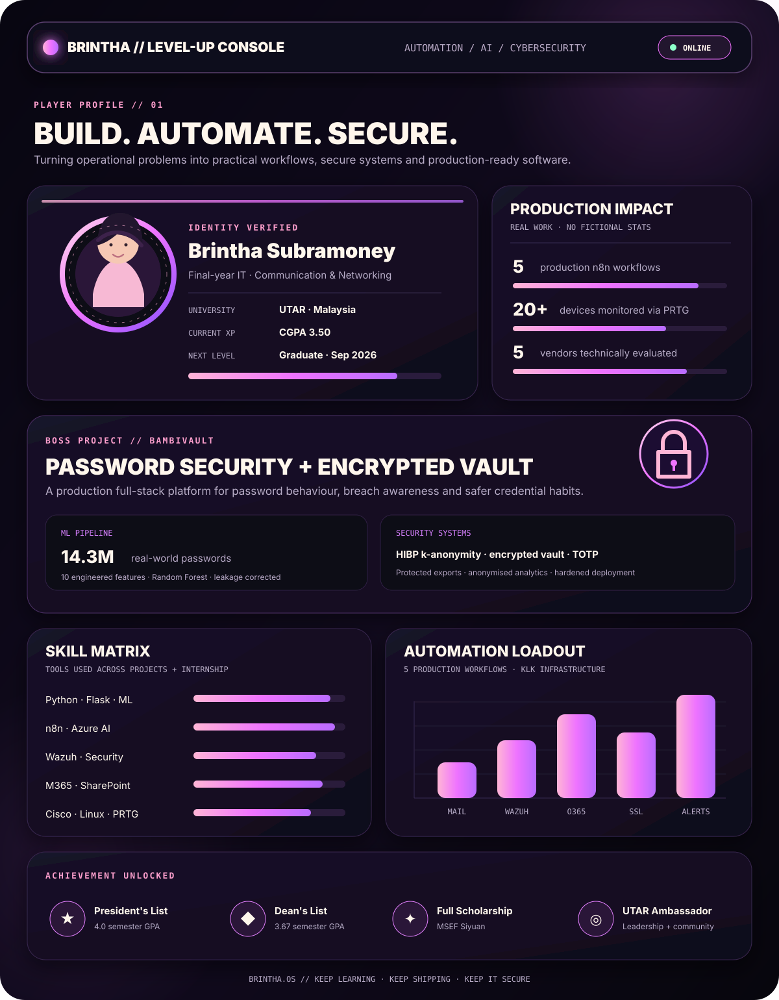

<!-- BRINTHA.OS · Level-up dashboard edition -->

<p align="center">
  <a href="https://bambivault.com">
    
  </a>
</p>

<p align="center">
  <a href="https://bambivault.com"></a>
  <a href="https://github.com/brintha1926/bambivault"></a>
  <a href="https://www.linkedin.com/in/brintha-subra/"></a>
</p>

<p align="center">
  <code>FINAL-YEAR IT</code> · <code>AUTOMATION</code> · <code>AI/ML</code> · <code>CYBERSECURITY</code> · <code>INFRASTRUCTURE</code>
</p>

## `MISSION // ABOUT`

I'm **Brintha Subramoney**, a final-year Bachelor of Information Technology (Honours) student specialising in Communication & Networking at **Universiti Tunku Abdul Rahman**.

I like the useful middle ground between software, automation and infrastructure: building systems that remove repetitive work, make security signals easier to act on, and turn technical ideas into something people can actually use.

```text
CURRENT QUEST   Graduate in September 2026
CORE FOCUS      Automation · AI/ML · Cybersecurity · Infrastructure
HOME BASE       Malaysia 🇲🇾
```

## `BOSS PROJECT // BAMBIVAULT`

### [BambiVault — Password Security & Encrypted Vault Platform](https://bambivault.com)

A production full-stack platform for evaluating password behaviour and security awareness among university students.

- Engineered a **10-feature extraction pipeline** spanning Shannon entropy, character classes, keyboard walks, substitutions and behavioural patterns.
- Trained an experimental **Random Forest model on 14.3 million real-world passwords** and corrected circular label leakage that had created misleading accuracy.
- Integrated **Have I Been Pwned k-anonymity** checks without sending plaintext passwords.
- Built an encrypted credential vault, TOTP authentication, recovery controls, anonymised analytics, protected exports and a hardened deployment.

`Python` · `Flask` · `scikit-learn` · `pandas` · `PostgreSQL` · `SQLAlchemy` · `JavaScript` · `Tailwind CSS` · `Nginx`

## `PRODUCTION QUESTS // KLK`

During my IT Infrastructure internship at **Kuala Lumpur Kepong Berhad**, I:

- Delivered **5 production n8n workflows** using Azure AI, Wazuh SIEM, SharePoint, Entra ID and Microsoft Outlook.
- Automated email threat classification, O365 file-access alerts, abnormal security thresholds, website uptime checks and SSL-expiry notifications.
- Deployed PRTG monitoring across VLAN/DMZ segments for **20+ devices**, including SAP service availability.
- Evaluated VAPT and SharePoint solutions across **5 vendors** to support procurement decisions.
- Authored a Microsoft Purview administration guide adopted as the department standard.
- Supported AD-to-Juniper migration, VLAN trunking and day-to-day Microsoft 365 administration.

## `LOADOUT // TECH STACK`

| Zone | Tools |
|:--|:--|
| **Automation & AI** | Python, n8n, Azure AI, scikit-learn, pandas |
| **Cybersecurity** | Wazuh SIEM, HIBP k-anonymity, VAPT evaluation, TOTP, security alerting |
| **Cloud & Enterprise** | Microsoft 365, SharePoint, Entra ID, Outlook, Purview |
| **Networking & Ops** | Cisco, PRTG, VLAN/DMZ, Linux, Nginx |
| **Web & Data** | Flask, JavaScript, PostgreSQL, SQLAlchemy, Tailwind CSS |
| **Languages** | Python, JavaScript, C++, Java, C#, SQL, Bash |

## `ACHIEVEMENTS // UNLOCKED`

- **President's List** — 4.0 semester GPA
- **Dean's List** — 3.67 semester GPA
- **MSEF Siyuan Full Scholarship**
- **China Ambassador Scholarship**
- **UTAR Ambassador**
- Cisco Networking Academy: Introduction to Networks; Switching, Routing & Wireless; Enterprise Networking, Security & Automation

## `SIDE QUESTS // COMMUNITY`

- Student emcee and committee member for UTAR-FICT's intervarsity **The Amazing Cyberhunt** CTF.
- Volunteer coding instructor for rural SJK(T) students in Perak.
- Building and documenting projects that connect coursework with real operational problems.

## `PROJECT INVENTORY`

| Project | What it is | Launch |
|:--|:--|:--:|
| **BambiVault** | Password security, encrypted vault and ML-backed analysis | [Live](https://bambivault.com) · [Code](https://github.com/brintha1926/bambivault) |
| **Italian Food** | Public web project | [Code](https://github.com/brintha1926/italian-food) |
| **GROUP9** | Collaborative academic repository | [Code](https://github.com/brintha1926/GROUP9) |
| **Personal Site** | GitHub Pages foundation | [Code](https://github.com/brintha1926/brintha1926.github.io) |

<p align="center">
  
  
</p>

<p align="center"><sub><code>BRINTHA.OS</code> // keep learning · keep shipping · keep it secure 🌸</sub></p>
